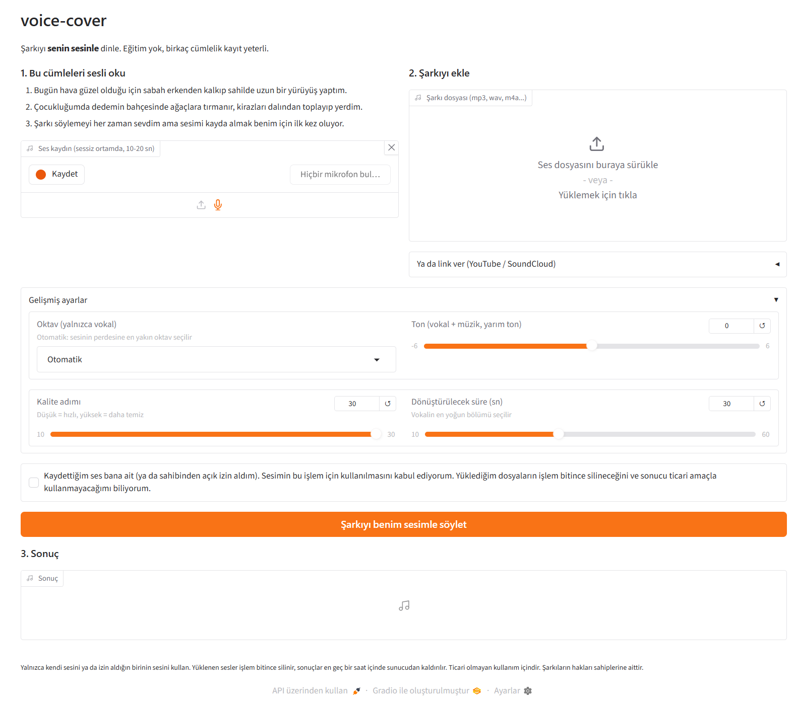
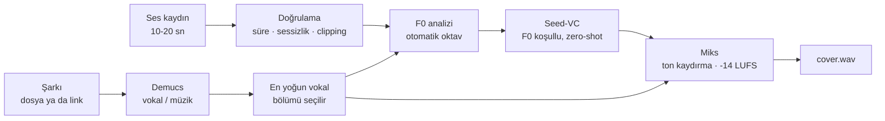

# voice-cover

Birkaç cümlelik ses kaydından, bir şarkıyı **senin sesinle** yeniden söyleten uçtan uca bir ses dönüştürme hattı. Model eğitimi yok, zero-shot çalışıyor.



## Nasıl çalışır



## Öne çıkan teknik kararlar

- **Lisans ve bağımlılık izolasyonu:** Seed-VC (GPL-3.0) kopyalanmadı. Sabit bir commit'te `third_party/` altına klonlanıyor ve kendi Python 3.10 venv'inde subprocess ile çalışıyor. Ana ortam (torch 2.11, Gradio 6) ile Seed-VC'nin istediği eski sürümler (torch 2.4, transformers 4.46, numpy 1.26) çakışmıyor.
- **Minimal bağımlılık:** Seed-VC'nin `requirements.txt` dosyası yerine `inference.py`'nin import zinciri izlendi. Derleme isteyen paketler (webrtcvad, funasr) olmadan, yalnızca gerçekten yüklenen 26 doğrudan bağımlılık sabit sürümle kuruluyor.
- **Perde mantığı:** Ton kaydırma vokal ve müziğe birlikte uygulanıyor. Oktav kaydırma yalnızca vokale uygulanıyor, çünkü notalar değişmiyor. Oktav, konuşma sesinin ve şarkının medyan F0 değerine göre otomatik seçiliyor.
- **Gizlilik:** Arayüz rıza onayı olmadan çalışmıyor. Yüklenen sesler ve ara dosyalar iş bitince (hata olsa da) siliniyor, sonuçlar en geç bir saatte temizleniyor.
- **Güvenli link desteği:** Link yolu yalnızca YouTube ve SoundCloud'a izin veriyor. Şarkı süresi indirmeden önce kontrol ediliyor.

## Ölçümler (GTX 1650, 4 GB)

| Senaryo | Seed-VC süresi | RTF | Tepe VRAM |
|---|---|---|---|
| 30 sn vokal, 30 adım | 515 sn | 16.4 | 3120 MB |
| 20 sn vokal, 15 adım (uçtan uca, toplam 224 sn) | 192 sn | 8.5 | 3120 MB |

Demucs ile ayırma 3,4 dakikalık bir şarkıda yaklaşık 22 sn sürüyor. Sürenin büyük kısmı difüzyon adımlarında geçiyor (adım başına yaklaşık 5 sn).

## Kurulum ve kullanım

```bash
pip install torch torchaudio --index-url https://download.pytorch.org/whl/cu128   # ortamına uygun sürüm
pip install -r requirements-dev.txt
python scripts/setup_seedvc.py      # Seed-VC'yi ayrı venv'e kurar (Python 3.10 gerekir)

python app.py                                                  # arayüz: http://127.0.0.1:7860
python cli.py --ref ses.wav --song sarki.mp3 --out cover.wav   # komut satırı
pytest -m "not slow"                                           # 85 hızlı test
```

## Proje yapısı

```
src/voice_cover/   audio_utils · fetch · separate · convert · mix · pipeline
app.py             Gradio arayüzü (mobil uyumlu)
cli.py             komut satırı
scripts/           Seed-VC kurulumu, deneme betiği
tests/             pytest (Seed-VC ve Demucs mock'lanır, slow testler gerçek çalışır)
```

## Kullanılan bileşenler ve lisanslar

| Bileşen | Görev | Lisans |
|---|---|---|
| Seed-VC | Ses dönüştürme | GPL-3.0 (kod ve model ağırlıkları) |
| BigVGAN (nvidia/bigvgan_v2_44khz_128band_512x) | Vocoder | MIT |
| whisper-small (openai) | İçerik çıkarımı | Apache-2.0 |
| CAM++ (funasr/campplus) | Konuşmacı gömmesi | Apache-2.0 |
| RMVPE (lj1995/VoiceConversionWebUI) | Perde (F0) çıkarımı | MIT + "yalnızca araştırma amaçlı" ek madde |
| Demucs | Vokal ayırma | MIT |
| Gradio | Arayüz | Apache-2.0 |
| yt-dlp | Linkten şarkı indirme | Unlicense |
| librosa | Ses işleme | ISC |
| pyloudnorm | Ses yüksekliği | MIT |
| soundfile, NumPy, PyTorch, torchaudio | Ses okuma/yazma, hesaplama | BSD-3-Clause |

Bu projenin kendi kodu [GPL-3.0](LICENSE) lisanslıdır.

## Ticari olmayan kullanım ve etik

Proje yalnızca kişisel ve araştırma amaçlı kullanım içindir. RMVPE'nin ek maddesi nedeniyle ticari kullanıma uygun değildir. Yalnızca kendi sesini ya da izin aldığın birinin sesini kullan. Şarkıların hakları sahiplerine aittir.
